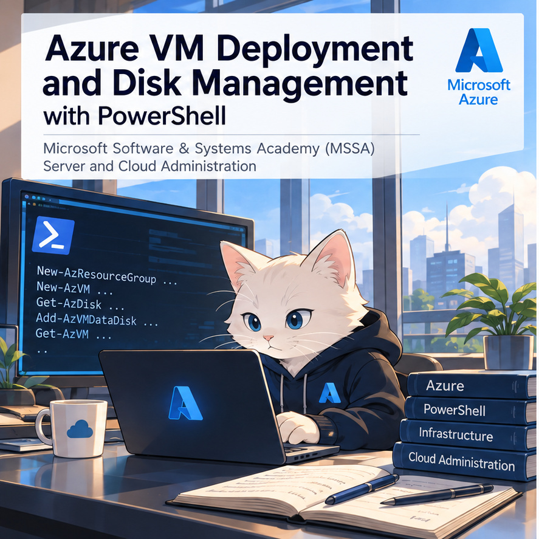
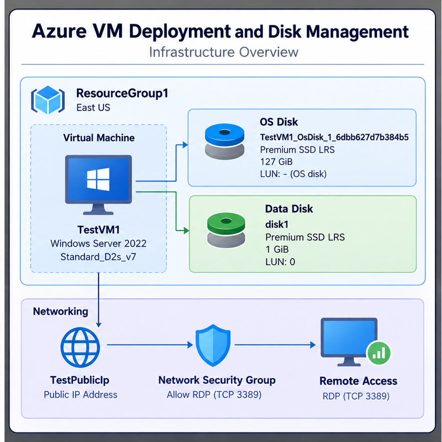
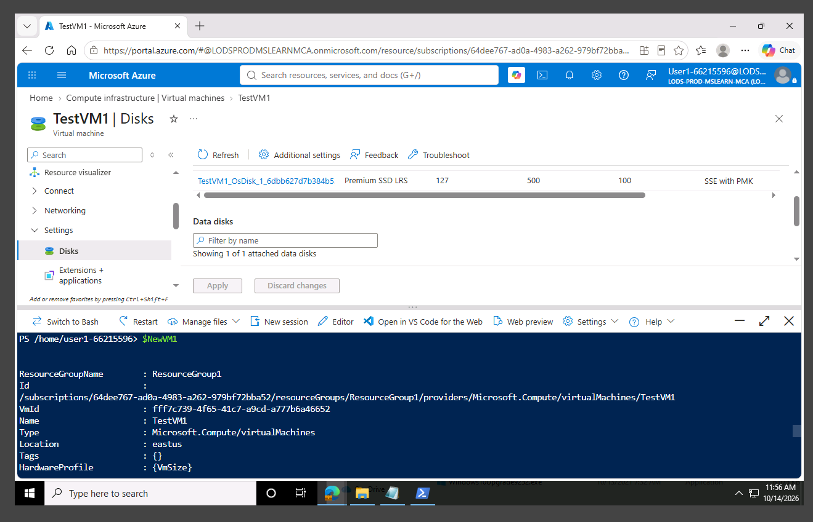
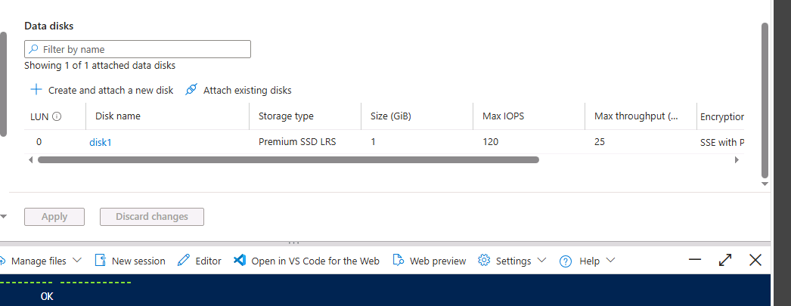

# Azure VM Deployment and Disk Management

**Windows Server Infrastructure with Azure PowerShell**  
Microsoft Software & Systems Academy (MSSA) — Server and Cloud Administration



## Project Overview

I deployed a Windows Server virtual machine in Microsoft Azure, verified remote administration, and attached a managed data disk using Azure PowerShell. The lab focused on managing an existing cloud resource through commands rather than relying only on the Azure Portal.

### Business Scenario

Adatum's London branch is evaluating Azure for Windows Server workloads. Before moving beyond a test environment, its IT team needs to know whether it can provision servers consistently, administer them remotely, and add storage without rebuilding a VM.

I worked through those requirements using Azure Cloud Shell and PowerShell, then checked the resulting infrastructure in the Azure Portal. The project demonstrates a small administration workflow, not a production deployment or a fully automated provisioning system.

**Technologies:** Microsoft Azure, Azure PowerShell, Azure Cloud Shell, Windows Server 2022 Azure Edition, Azure Managed Disks, RDP

---

## Lab Environment

| Component | Configuration |
|---|---|
| Resource group | `ResourceGroup1` |
| Region | East US (`eastus`) |
| Virtual machine | `TestVM1` |
| OS and VM size | Windows Server 2022 Azure Edition · `Standard_D2s_v7` |
| Public IP resource | `TestPublicIp` |
| Remote management | RDP over TCP 3389 |
| Additional data disk | `disk1` · 1 GiB · Premium SSD LRS · LUN 0 |
| Disk caching | ReadOnly |



*The diagram illustrates the lab environment. The screenshots below are from the actual Azure session.*

---

## 1. Deploy the Resource Group and Virtual Machine

I started by creating a resource group to keep the VM and its supporting resources together:

```powershell
New-AzResourceGroup -Name ResourceGroup1 -Location eastus
```

Azure returned a successful provisioning state. I then collected administrator credentials and used a PowerShell **hashtable** to hold the VM configuration:

```powershell
$cred = Get-Credential

$vmParams = @{
    ResourceGroupName  = 'ResourceGroup1'
    Name               = 'TestVM1'
    Size               = 'Standard_D2s_v7'
    Location           = 'eastus'
    ImageName          = 'Win2022AzureEdition'
    PublicIpAddressName = 'TestPublicIp'
    Credential         = $cred
    OpenPorts          = 3389
}

$newVM1 = New-AzVM @vmParams
```

Using **parameter splatting** kept the VM settings separate from the deployment command. This makes the configuration easier to review and provides a starting point for reusable scripts, although this lab was not a complete automation pipeline.

### Verification

I retrieved the resulting VM object and checked its OS and networking details:

```powershell
$newVM1
$newVM1.OSProfile | Select-Object ComputerName, AdminUserName
$newVM1 | Get-AzNetworkInterface |
    Select-Object -ExpandProperty IpConfigurations |
    Select-Object Name, PrivateIpAddress
```



The output identified `TestVM1` in `ResourceGroup1`, in the East US region. This verified the deployed Azure resource, while the next step checked whether the server was actually reachable.

## 2. Verify Remote Administration

I retrieved the VM's public IP resource using Azure PowerShell:

```powershell
$rgName = $newVM1.ResourceGroupName
$publicIp = Get-AzPublicIpAddress `
    -Name TestPublicIp `
    -ResourceGroupName $rgName

$publicIp | Select-Object Name, IpAddress,
    @{Label='FQDN'; Expression={$_.DnsSettings.Fqdn}}
```

From the Windows lab client, I connected through **Remote Desktop Protocol (RDP)**, authenticated to the Windows Server 2022 VM, and accessed Server Manager.

That test mattered because a successful VM deployment command alone does not establish that the guest operating system is accessible for administration.

**Security consideration:** Opening TCP 3389 made remote access straightforward in the lab. For production, RDP exposure should be restricted to trusted management sources or replaced with a controlled access method such as Azure Bastion. I did not configure those production controls in this exercise.

## 3. Attach a Managed Data Disk

The next requirement was to add storage to the existing VM **without rebuilding it**. Azure managed disks allow data storage to be managed separately from the operating system disk.

I retrieved `TestVM1`, added a data disk to its PowerShell configuration, and submitted the updated VM object:

```powershell
$VirtualMachine = Get-AzVM `
    -ResourceGroupName 'ResourceGroup1' `
    -Name 'TestVM1'

Add-AzVMDataDisk `
    -VM $VirtualMachine `
    -Name 'disk1' `
    -LUN 0 `
    -Caching ReadOnly `
    -DiskSizeinGB 1 `
    -CreateOption Empty

Update-AzVM `
    -ResourceGroupName 'ResourceGroup1' `
    -VM $VirtualMachine
```

The distinction between the last two commands was useful: **`Add-AzVMDataDisk` changes the local VM configuration object; `Update-AzVM` applies the change to Azure.**

### Verification

In the Azure Portal, I opened **TestVM1 → Disks** and confirmed that `disk1` appeared under Data disks.



| Verified property | Result |
|---|---|
| Disk name | `disk1` |
| Size | 1 GiB |
| Storage type | Premium SSD LRS |
| LUN | 0 |
| Attachment | Displayed under TestVM1 data disks |

**Result:** The managed disk was attached to the existing VM. The screenshot does not demonstrate that the disk was initialized, partitioned, or formatted inside Windows; guest-level storage configuration was outside this lab's verified scope.

---

## Troubleshooting

The lab also involved several practical problems:

| Issue | Response and lesson |
|---|---|
| **Az.Accounts failed to load** | A `Microsoft.ApplicationInsights` assembly dependency caused a module error. I updated PowerShell and moved to PowerShell 7, after which Azure authentication worked. |
| **Cloud Shell session restarted** | The credential variable was lost. I recreated it with `Get-Credential` and reassigned `$vmParams.Credential = $cred`. Hashtable values do not automatically update when the original variable changes. |
| **VM deployment errors** | I investigated a *Subscription not found* error by checking subscription and resource state; its exact cause was not established. A separate password-complexity error was addressed by correcting administrator credentials. |
| **RDP command in the wrong environment** | `mstsc.exe` failed in Linux-based Azure Cloud Shell. I switched to Remote Desktop Connection on the Windows lab client. |

These issues reinforced that cloud administration requires understanding **PowerShell sessions, module dependencies, Azure resource state, and where commands actually run**—not just knowing the right cmdlets.

## Results and Operational Value

| Requirement | Demonstrated result |
|---|---|
| Provision cloud infrastructure | Resource group and Windows Server VM created |
| Inspect deployment | VM and networking details retrieved through PowerShell |
| Administer the server remotely | RDP connection and Server Manager access confirmed |
| Expand existing VM storage | 1 GiB managed disk attached and visible in Azure Portal |

The workflow shows how a systems administrator can provision and inspect Azure resources, connect to a Windows Server instance, and modify storage after deployment. Hashtable-based configuration and PowerShell cmdlets provide a foundation for repeatable administration, but **no production-scale time or cost savings were measured**.

The lab included `Remove-AzResourceGroup -Name ResourceGroup1 -Force` as a cleanup procedure. Final cleanup was not independently verified in the retained evidence; resource-group deletion is destructive and should only be run after checking dependencies and retention requirements.

## What I Learned

The most useful part was understanding the difference between **describing a desired configuration** and **applying it to a running Azure resource**. I also saw why deployment verification has multiple parts: PowerShell can confirm the Azure VM object, RDP checks actual server access, and the Portal confirms the managed disk attachment.

**Skills practiced:** Azure PowerShell · VM Provisioning · Parameter Splatting · Azure Networking · Remote Administration · Azure Managed Disks · VM Configuration Updates · Troubleshooting